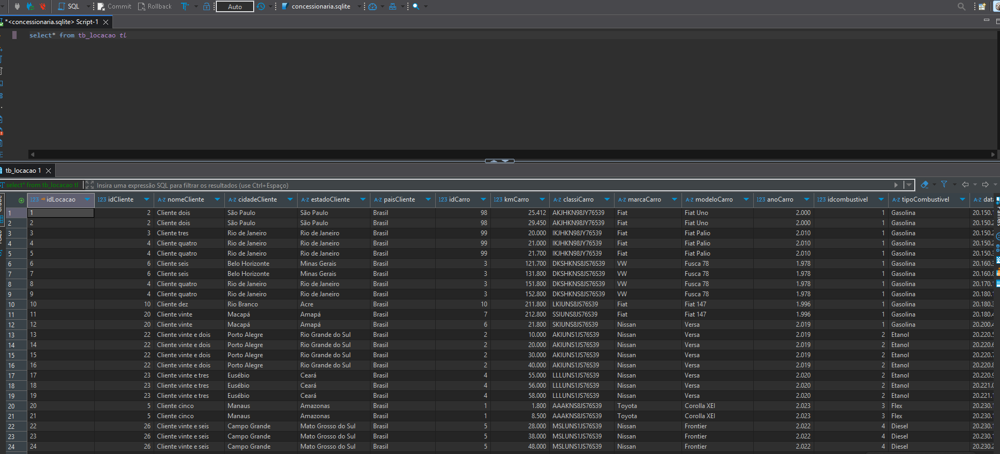
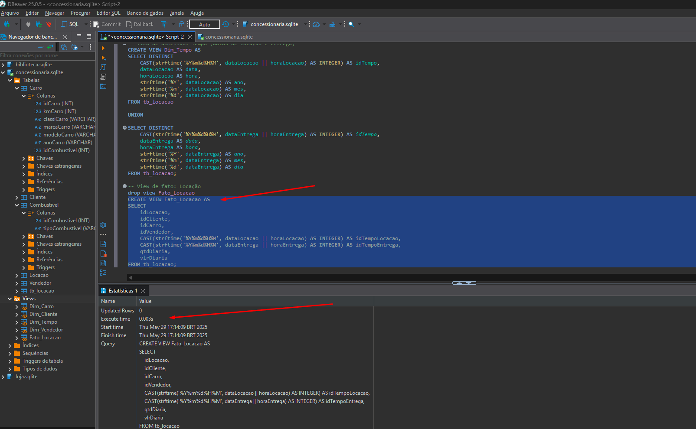
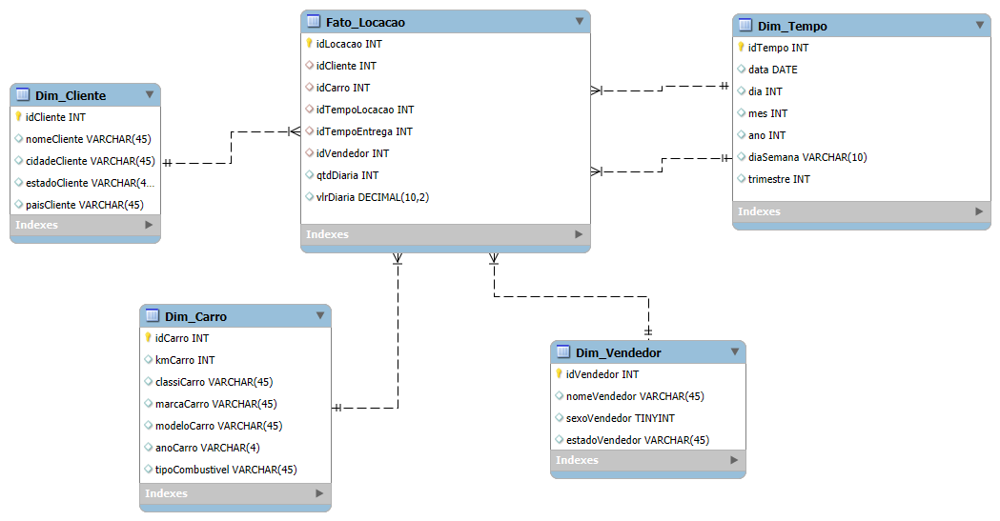

# Etapas


1. ... [Etapa I](etapa-1)

    Nessa etapa dei início ao modelo relacional lógico, comecei olhando o que tinhamos no banco disponibilizado e fui criando as tabelas no MySQL Workbench.
    Foi uma etapa mais tranquila, pois já tinha feito antes, comecei a organizar as tabelas, separar as PKs e FKs.
    Como pode se ver em abaixo:

    

    

    

    Depois de criado as tabelas com suas respectivas FKs, PKs e relacionamentos entre si, exportei o código SQL e fiz algumas mudanças evidenciado em:

    

    Logo após rodei os scripts atualizados que foram criados com a ajuda do MySQL Workbench e criei as tabelas, evidenciado em:

    

    ## 📦 Resultado Final - Relacional

    O resultado final do da etapa 1 do desafio (modelagem relacional) está disponível na pasta [etapa-1](../Desafio/etapa-1).

    


2. ... [Etapa 2](etapa-2)

    Dei inicio a modelagem dimensional, algo que nunca tinha estudado antes, comecei separando as tabelas dimensão e fato, conforme o vídeo de explicação do desafio, após ter estudado esse modelo e assistido o vídeo do Alex, sobre seu projeto de Data Warehouse no Youtube. Também conversei com o monitor Daniel, sobre algumas dúvidas na tabela Dim_tempo. Comecei a relacionar as tabelas e criá-las como pode evidenciar em:

    

    Após isso, tive que fazer os scritps de criação das VIEWS, criei as views e conferi se tudo estava correto. Aqui, como não tive o auxilio na criação das queries, essa parte de criação da view dim_tempo acabou tomando um pouco mais do meu tempo, por causa da lógica.

```
-- View de dimensão: Tempo (datas de locação e entrega)
CREATE VIEW Dim_Tempo AS
SELECT DISTINCT 
    CAST(strftime('%Y%m%d%H%M', dataLocacao || horaLocacao) AS INTEGER) AS idTempo,
    dataLocacao AS data,
    horaLocacao AS hora,
    strftime('%Y', dataLocacao) AS ano,
    strftime('%m', dataLocacao) AS mes,
    strftime('%d', dataLocacao) AS dia
FROM tb_locacao

UNION

SELECT DISTINCT 
    CAST(strftime('%Y%m%d%H%M', dataEntrega || horaEntrega) AS INTEGER) AS idTempo,
    dataEntrega AS data,
    horaEntrega AS hora,
    strftime('%Y', dataEntrega) AS ano,
    strftime('%m', dataEntrega) AS mes,
    strftime('%d', dataEntrega) AS dia
FROM tb_locacao;
```



Com a criação das views, encerrei o modelo dimensional com êxito.
    
## 📦 Resultado Final - Dimensional

O resultado final do desafio etapa 2 (modelagem dimensional)  está disponível na pasta [etapa-2](../Desafio/etapa-2).

