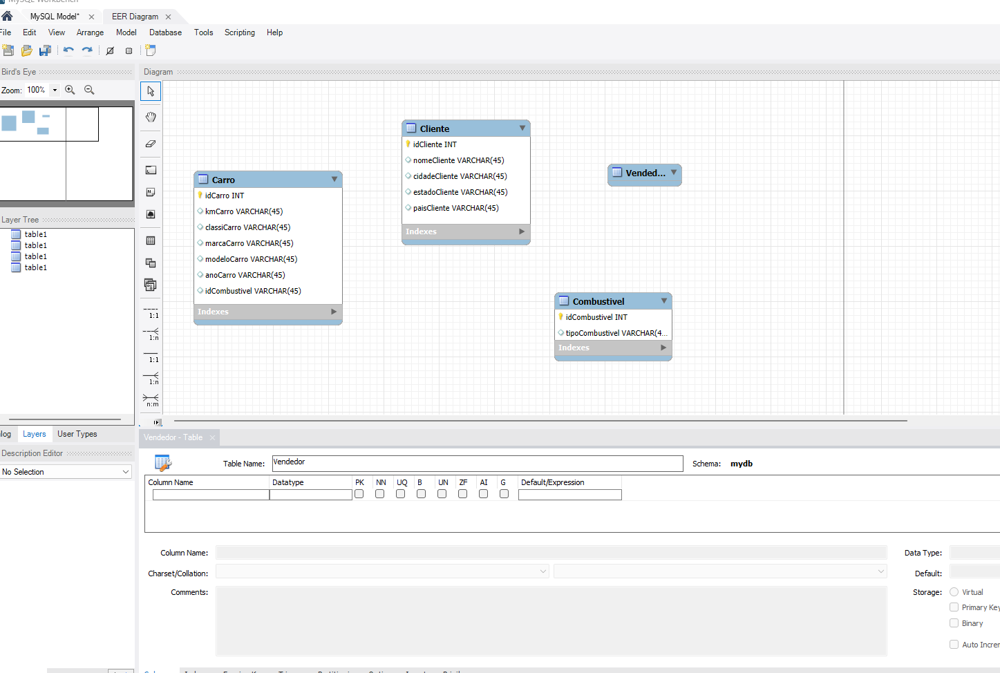
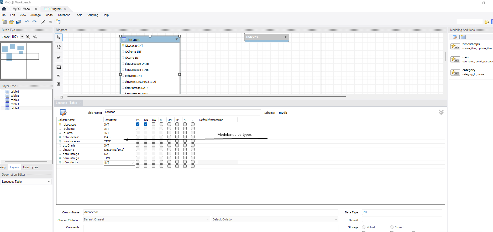
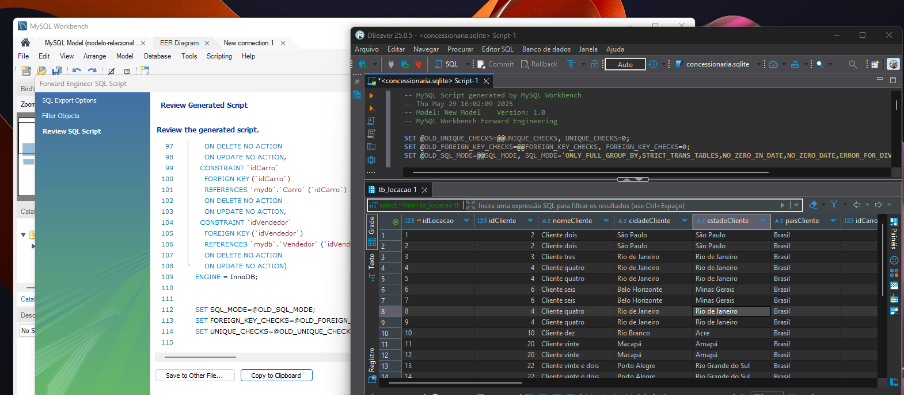
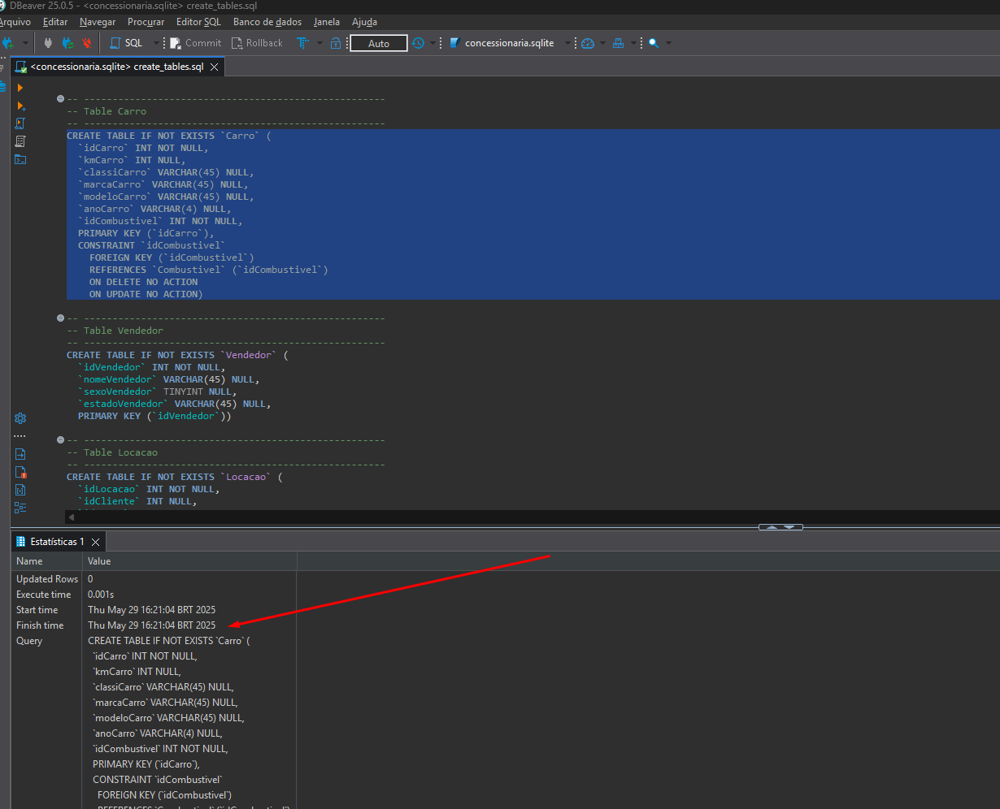
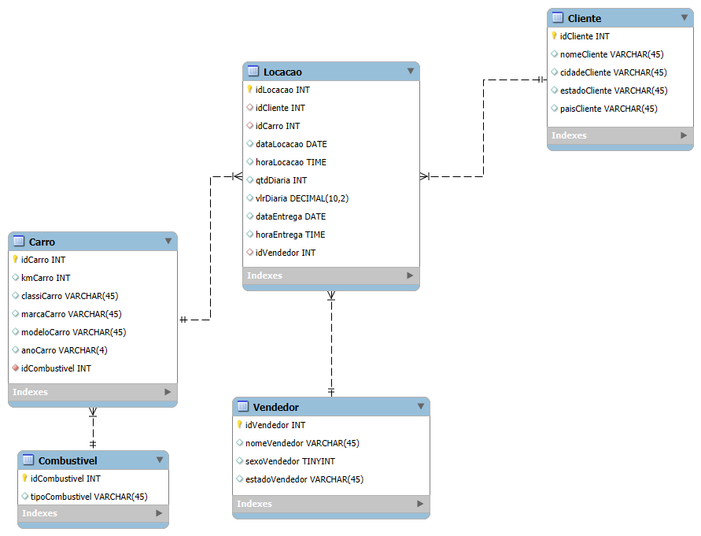
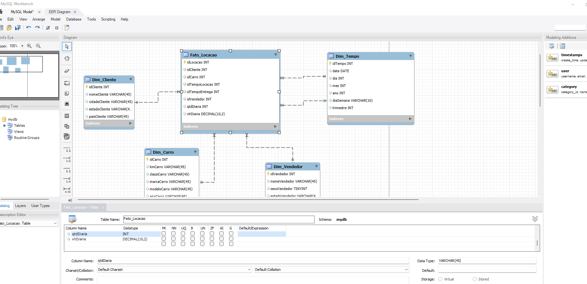
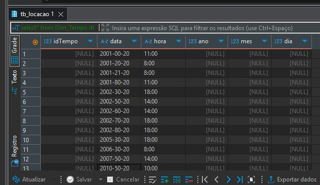
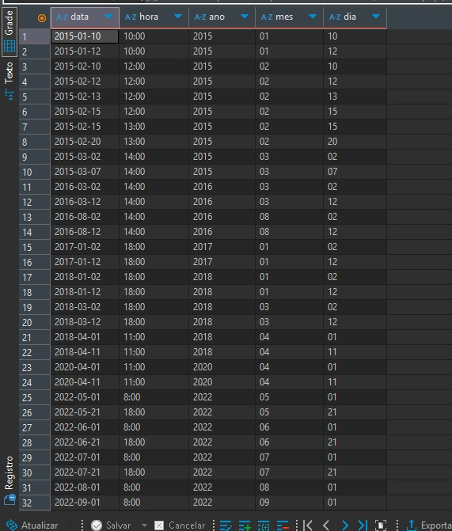
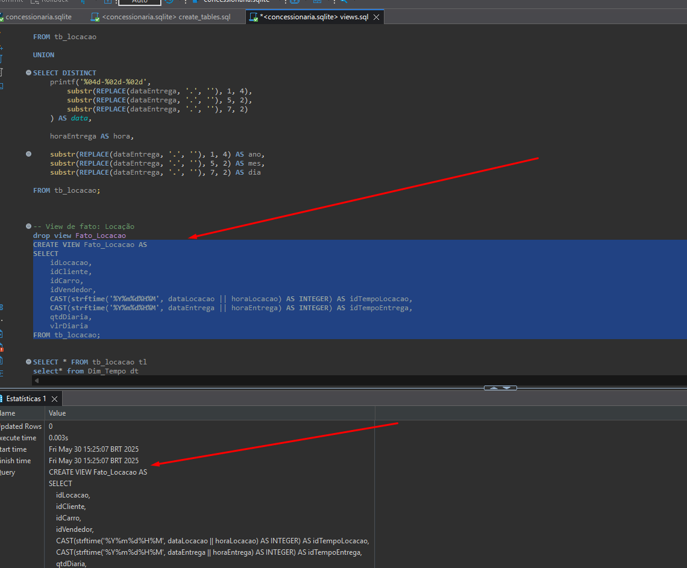
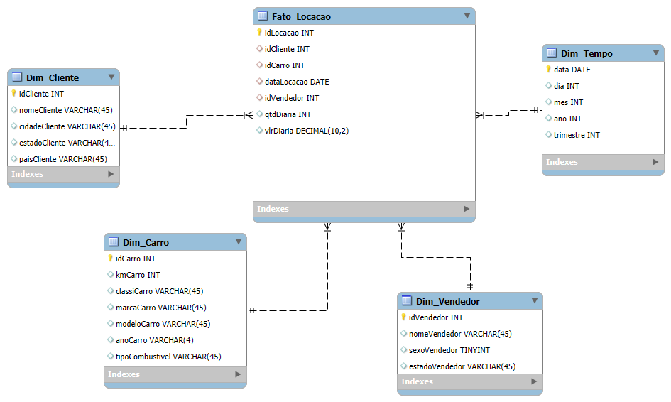

# Etapas

# Primeira Etapa

1. ... [Etapa I](etapa-1)

    Nessa etapa dei início ao modelo relacional lógico, comecei olhando o que tinhamos no banco disponibilizado e fui criando as tabelas no MySQL Workbench.
    Foi uma etapa mais tranquila, pois já tinha feito antes, comecei a organizar as tabelas, separar as PKs e FKs e os data types.
    Como pode se ver em abaixo:

    

    

    

    Depois de criado as tabelas com suas respectivas FKs, PKs e relacionamentos entre si, exportei o código SQL e fiz algumas mudanças evidenciado em:

    

    Logo após rodei os scripts atualizados que foram criados com a ajuda do MySQL Workbench e criei as tabelas, evidenciado em:

    

## 📦 Resultado Final - Relacional

O resultado final do da etapa 1 do desafio (modelagem relacional) juntamente com o código de criação das tabelas está disponível na pasta [etapa-1](../Desafio/etapa-1).


---
# Segunda etapa

2. ... [Etapa 2](etapa-2)

Dei inicio a modelagem dimensional, algo que nunca tinha estudado antes, comecei separando as tabelas dimensão e fato, conforme o vídeo de explicação do desafio, após ter estudado esse modelo e assistido o vídeo do Alex, sobre seu projeto de Data Warehouse no Youtube. Também conversei com o monitor Daniel, sobre algumas dúvidas na tabela Dim_tempo. Comecei a relacionar as tabelas e criá-las como pode evidenciar em:



Após isso, tive que fazer os scritps de criação das VIEWS, criei as views e conferi se tudo estava correto. Aqui, como não tive o auxilio na criação das queries, essa parte de criação da view Dim_Tempo acabou tomando um pouco mais do meu tempo, por causa da lógica do tratamento dos dados, após várias tentativas:
    

    
esse foi o resultado do código:

```
-- View de dimensão: Tempo (datas de locação e entrega)
CREATE VIEW Dim_Tempo AS
SELECT DISTINCT
    printf('%04d-%02d-%02d',
        substr(REPLACE(dataLocacao, '.', ''), 1, 4),
        substr(REPLACE(dataLocacao, '.', ''), 5, 2),
        substr(REPLACE(dataLocacao, '.', ''), 7, 2)
    ) AS data,

    horaLocacao AS hora,

    substr(REPLACE(dataLocacao, '.', ''), 1, 4) AS ano,
    substr(REPLACE(dataLocacao, '.', ''), 5, 2) AS mes,
    substr(REPLACE(dataLocacao, '.', ''), 7, 2) AS dia

FROM tb_locacao

UNION

SELECT DISTINCT
    printf('%04d-%02d-%02d',
        substr(REPLACE(dataEntrega, '.', ''), 1, 4),
        substr(REPLACE(dataEntrega, '.', ''), 5, 2),
        substr(REPLACE(dataEntrega, '.', ''), 7, 2)
    ) AS data,

    horaEntrega AS hora,

    substr(REPLACE(dataEntrega, '.', ''), 1, 4) AS ano,
    substr(REPLACE(dataEntrega, '.', ''), 5, 2) AS mes,
    substr(REPLACE(dataEntrega, '.', ''), 7, 2) AS dia

FROM tb_locacao;
```
O resultado do tratamento:



Logo após, views criadas:



Com a criação das views, encerrei o modelo dimensional com êxito.
    
## 📦 Resultado Final - Dimensional

O resultado final do desafio etapa 2 (modelagem dimensional) e código da criação das views está disponível na pasta [etapa-2](../Desafio/etapa-2).

