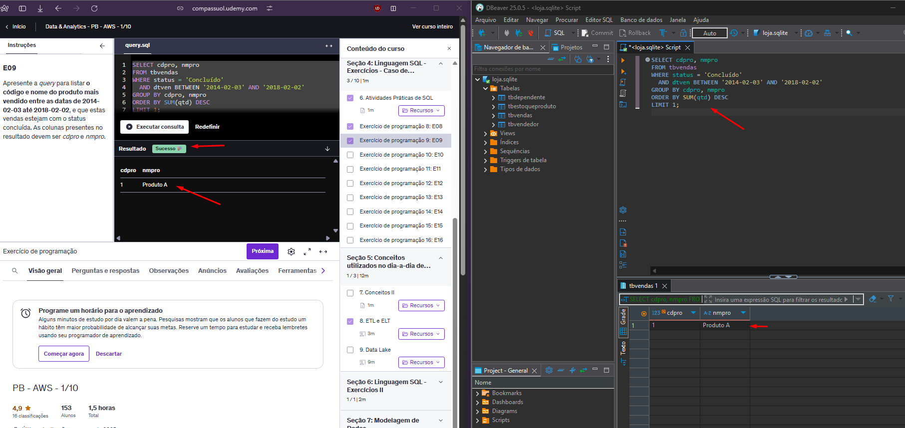
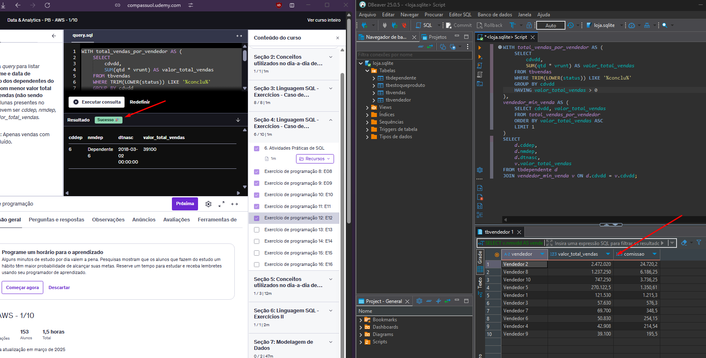
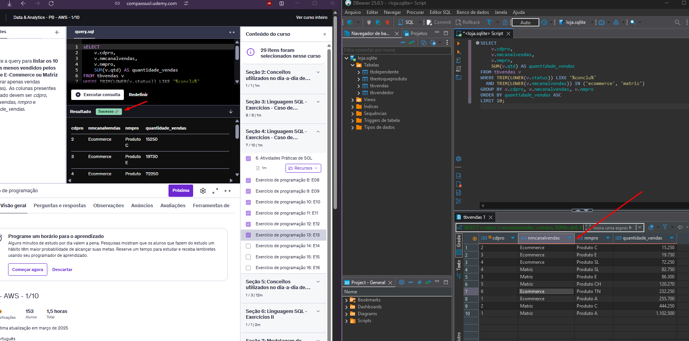
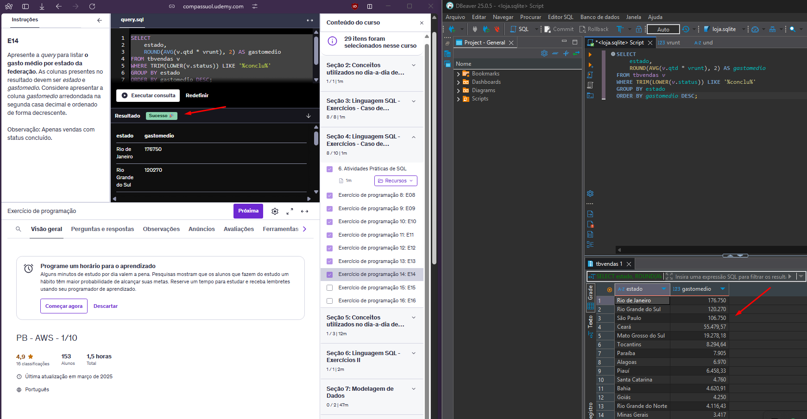
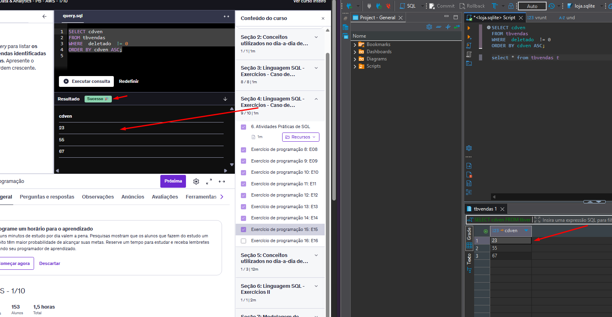
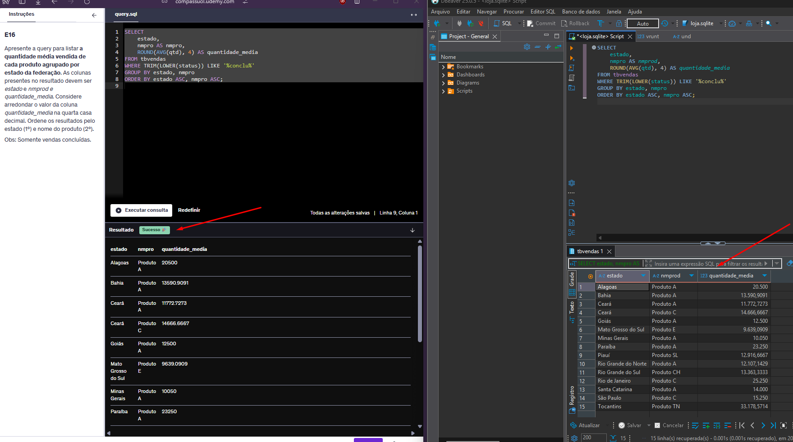
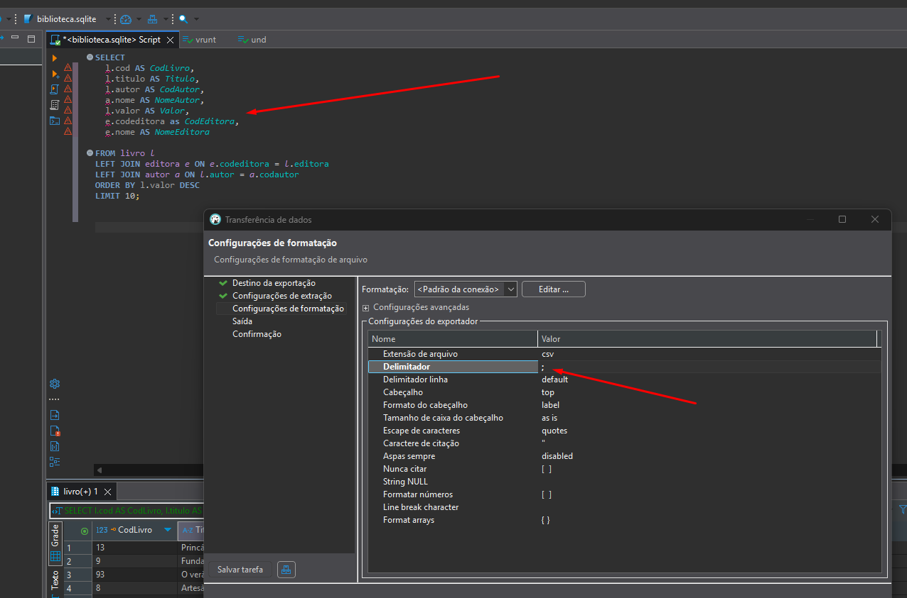
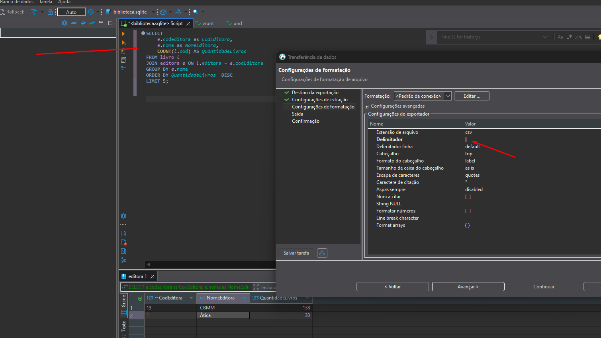

# Resumo

**Sql:** Durante o curso de SQL para análise de dados, pude relembrar alguns conceitos e me aprofundar em outros novos para o tratamento de dados. Entre os novos aprendizados, destaco o uso da função date_trunc, que até então não conhecia. Relembrei a execução e criação de queries simples e complexas, utilizando os operadores lógicos, o uso de subqueries e funções agregadas como COUNT(), SUM (), entre outras. Também relembrei como manipular os dados, inserir, atualizá-los e deletá-los. Estudei e apliquei os JOINS e o UNION para combinar tabelas. No curso, desenvolvi um dashboard de vendas, onde utilizei o excel para geral gráficos com base nas queries desenvolvidas. Consegui entender melhor o uso das funções de transformação de dados na prática e seu uso, como o REPLACE().

**Data e Analytics:** Durante o curso de Data e Analytics, aprendi alguns conceitos em Big Data e suas principais características, conceitos em Ciência de Dados, além dos papéis e perfis dos profissionais da área. Estudei também os tipos de dados (estruturados, semi estruturados e não estruturados) e de banco de dados (NoSQL e RDBMS). Pude me aprofundar também alguns fundamentos sobre Business Inteligence, técnicas de processamento de dados (Batch e Stream), adquiri uma base em Machine Learning, seus algoritmos e quando são utilizados, assim como outros conceitos mais específicos em ML como Deep Learning e exemplos práticos no dia a dia. Estudei um pouco sobre Dashboards e porque são importantes para o gerenciamento de uma empresa. Aprendi também alguns fundamentos básicos em mineração de dados, IoT, o papel das APIs na integração de um sistema, métodos de conexão a banco de dados e sua história, além de compreender um pouco sobre as interfaces de conexão entre softwares e bancos de dados, ODBC e JDBC, e suas diferenças.
Aprendi também sobre Extração, Transformação e Carregamento de Dados (ETL) e algumas das ferramentas mais utilizadas. Diferenças entre ETL e ELT, suas utilizações e benefícios. Explorei também um pouco sobre Arquitetura Lambda, o que é um Data Lake, suas características e sua grande vantagem, a flexibilidade.

**Modelagem Relacional e Dimensional:** Pude aprofundar meus conhecimentos em modelagem de dados, compreendendo as diferenças e aplicações da modelagem relacional e dimensional, trabalhando com ambas na prática e teoria. Aprendi conceitos e fundamentos importantes desde a história da modelagem relacional, tipos de modelos de dados, conceitos importantes como cardinalidade, integridade do domínio e normalização, granularidade e muitos outros. Aprendi como estruturar dados de forma normalizada, construir modelos relacionais e dimensionais além de transfrmar um modelo relacional em dimensional, entendi a aplicação dos dimensionais que facilitam a análise por meio de tabelas fato e dimensões. Li um pouco sobre métricas e seus tipos, Também melhorei minhas habilidades práticas em SQL para criar views e toda a lógica dos scripts.

# 📊 Exercícios de SQL

Este repositório contém as respostas dos exercícios em SQL, organizadas por seções. Para alguns exercícios, há também uma imagem de evidência com o resultado da consulta no Dbeaver juntamente com a resposta na plataforma Air Learning.

# Lista de Exercícios

## Seção 03 – Biblioteca 📖

1. [Exercício 1](./Exercicios/Secao-03-Biblioteca/ex01.sql)  
2. [Exercício 2](./Exercicios/Secao-03-Biblioteca/ex02.sql)  
3. [Exercício 3](./Exercicios/Secao-03-Biblioteca/ex03.sql)  
4. [Exercício 4](./Exercicios/Secao-03-Biblioteca/ex04.sql)  
5. [Exercício 5](./Exercicios/Secao-03-Biblioteca/ex05.sql)  
6. [Exercício 6](./Exercicios/Secao-03-Biblioteca/ex06.sql)  
7. [Exercício 7](./Exercicios/Secao-03-Biblioteca/ex07.sql)  

---

## Seção 04 – Loja 🛍️ 

8. [Exercício 8](./Exercicios/Secao-04-Loja/ex8.sql)  
9. [Exercício 9](./Exercicios/Secao-04-Loja/ex9.sql)  
     

10. [Exercício 10](./Exercicios/Secao-04-Loja/ex10.sql)  
11. [Exercício 11](./Exercicios/Secao-04-Loja/ex11.sql)  
12. [Exercício 12](./Exercicios/Secao-04-Loja/ex12.sql)  
      

13. [Exercício 13](./Exercicios/Secao-04-Loja/ex13.sql)  
      

14. [Exercício 14](./Exercicios/Secao-04-Loja/ex14.sql)  
      

15. [Exercício 15](./Exercicios/Secao-04-Loja/ex15.sql)  
      

16. [Exercício 16](./Exercicios/Secao-04-Loja/ex16.sql)  
     

## Seção 06 – CSV🧾 

1. [Exercício 1](./Exercicios/Secao-06-CSV/livros.csv)  
     

2. [Exercício 2](./Exercicios/Secao-06-CSV/editora.csv)  
     

# Evidências

Ao executar o código do exercício ... observei que ... conforme podemos ver na imagem a seguir:

