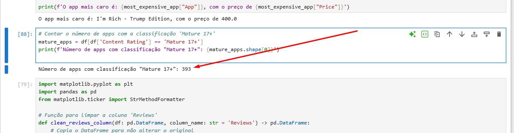
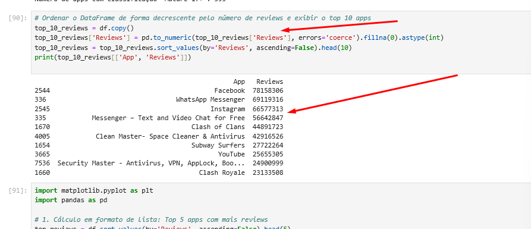
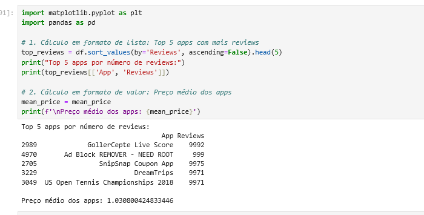
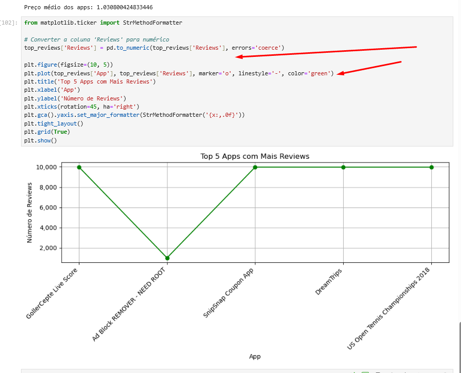
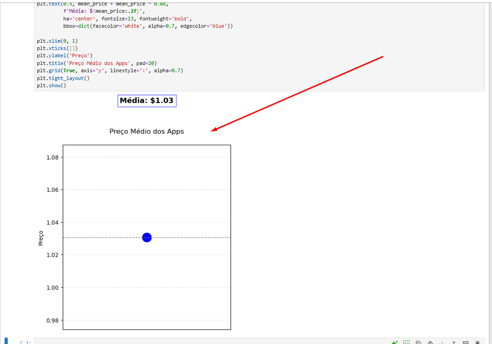

## Etapas

### Etapa 1. **Carregar o dataset e remoção das linhas duplicadas**

A primeira etapa do projeto é carregar o dataset. O arquivo `.csv` e visualizar as primeiras linhas para verificar os dados disponíveis.
Abaixo, como importei e removi as linhas duplicadas com base na coluna `'App'`.

### 2. **Limpeza de Dados - Installs**

A coluna **`Installs`** contém valores não numéricos, como símbolos de `+` e vírgulas `,`. Esses caracteres foram removidos para que realizar as análises da melhor forma.

Aqui eu copiei o df, removi os carateres não numéricos usando str.replace() e (regex=True) limpando os valores. Substituindo os vazios por 0 e convertendo para int com astype(int). 

### 3. **Análise de Top 5 Apps por Instalações**

Nesta etapa, usei o método **`nlargest()`** para identificar os 5 aplicativos com o maior número de instalações, essa foi a primeira versão do gráfico que ficou com a visualização comprometida:

Após os ajustes para melhorar a formatação cheguei ao seguinte resultado: 

### 5. **Análise de Categorias de Apps**

Gerei um gráfico de pizza para visualizar a distribuição das categorias de aplicativos na Play Store aqui usei matplotlib para representar as proporções. Essa foi a primeira versão, de dificil visualização:

Após os ajustes para melhorar a visualização trazendo somente as 20 categorias mas frequentes ajustando diversos pontos como: legibilidade, layout e evitar as sobreposicões,  o gráfico final ficou da seguinte maneira:

### 6. **Encontre o App Mais Caro**

Aqui para determinar o app mais caro converti a coluna 'Price' para valores numéricos, removi o símbolo de moeda e tratei os respectivos erros. Em seguida, ele removi linhas com preços ausentes e printei o nome e o preço do aplicativo mais caro.

### 7. **Contagem de Apps com a Classificação 'Mature 17+'**

Com este código, eu filtrei meu df para incluir apenas os apps com classificação Mature 17+ e, em seguida, printei o total desses apps.

### 8. **Top 10 Apps por Número de Reviews**

Gerei uma lista ordenada de forma decrescente pelo número de reviews. Convertendo a coluna Reviews para valores numéricos, tratando valores ausentes e ordena os aplicativos por número de reviews de forma decrescente. Em seguida, exibindo os 10 aplicativos com mais reviews, mostrando seu nome e o número de reviews.

### 9. **Cálculos sobre o Dataset**

Copiei o df, tratei e converti a coluna 'Reviews' para números inteiros, e então ordenei para encontrar e exibir os top 10 aplicativos com mais reviews

### 10. **Gráficos de Análise Adicional**

Gerei gráficos adicionais para os indicadores da etapa anterior, um gráfico de linha e outro de ponto.

No de linha, converto a coluna 'Reviews' para numérica e, em seguida, ploto os top 5 aplicativos por reviews, formatando o eixo Y para exibir os números de reviews de forma legível e sem notação científica.

O de ponto, criei um gráfico para exibir o preço médio dos apps como um ponto centralizado, com uma linha horizontal e um rótulo de texto destacado para indicar seu valor. 

## Conclusão

Este desafio me proporcionou uma análise detalhada do dataset de aplicativos da Google Play Store, focando na distribuição das categorias, popularidade e preço médio. Aprendi a limpar e preparar os dados usando pandas, além de criar gráficos de diferentes tipos e como melhorá-los com o matplotlib. O desafio foi crucial para o aprimoramento das minhas habilidades em análise e visualização de dados.