## Etapas

### Etapa 1. **Carregar o dataset e remoção das linhas duplicadas**

A primeira etapa do projeto é carregar o dataset. O arquivo `.csv` e visualizar as primeiras linhas para verificar os dados disponíveis.
Abaixo, como importei e removi as linhas duplicadas.

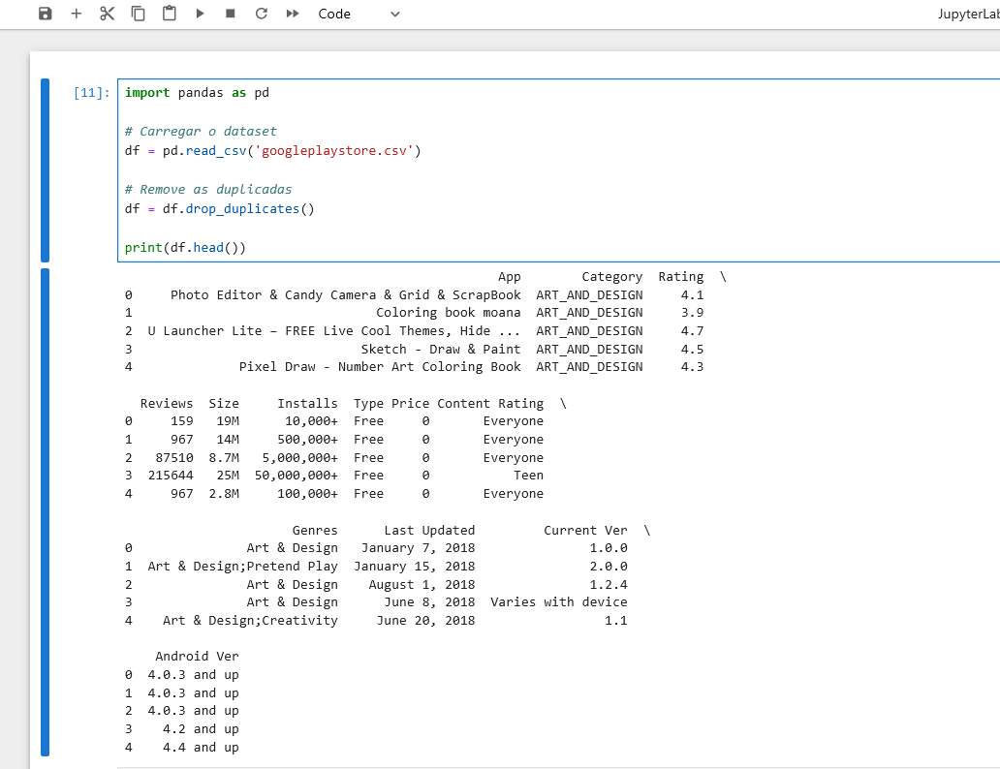

Nessa parte fiz alguns testes como visualizar as duplicadas e visualizar sua remoção, como é possível verificar abaixo:

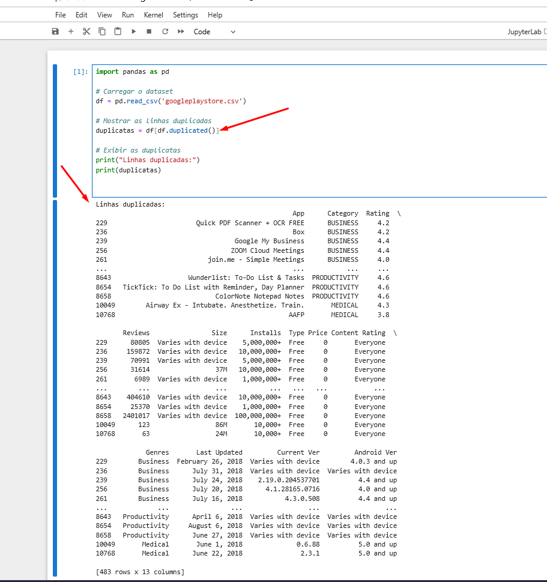
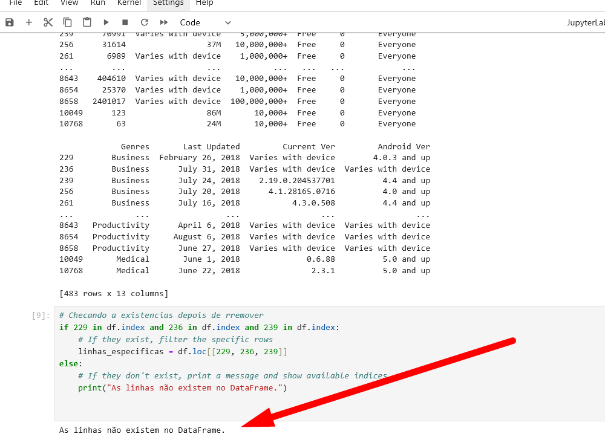
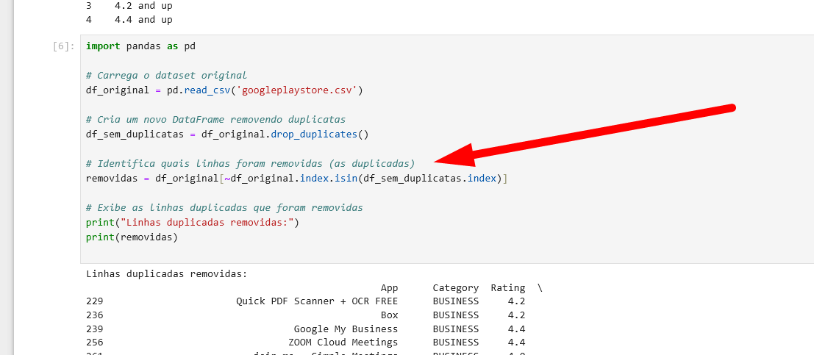

### 2. **Limpeza de Dados - Installs**

A coluna **`Installs`** contém valores não numéricos, como símbolos de `+` e vírgulas `,`. Esses caracteres foram removidos para que realizar as análises da melhor forma.

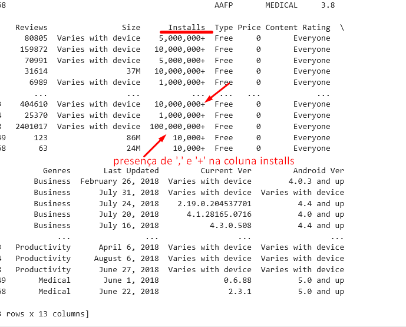

Aqui eu copiei o df, removi os carateres não numéricos usando str.replace() e (regex=True) limpando os valores. Substituindo os vazios por 0 e convertendo para int com astype(int). 

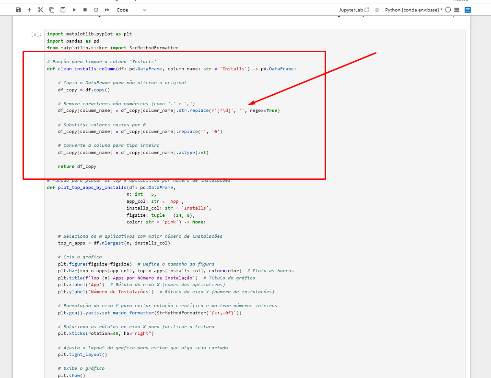

### 3. **Análise de Top 5 Apps por Instalações**

Nesta etapa, usei o método **`nlargest()`** para identificar os 5 aplicativos com o maior número de instalações, essa foi a primeira versão do gráfico que ficou com a visualização comprometida:

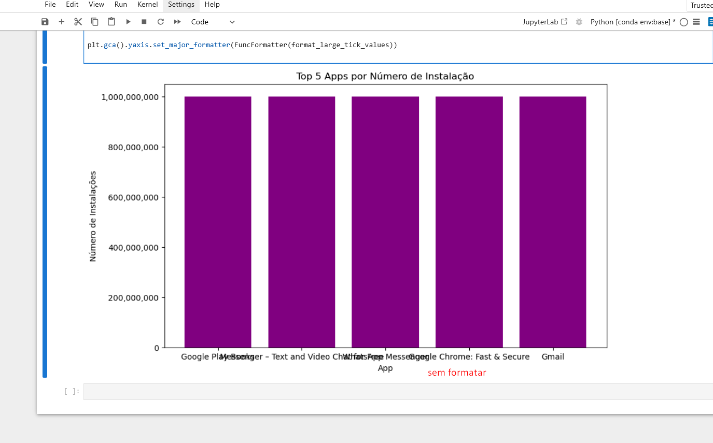

Após os ajustes para melhorar a formatação cheguei ao seguinte resultado: 

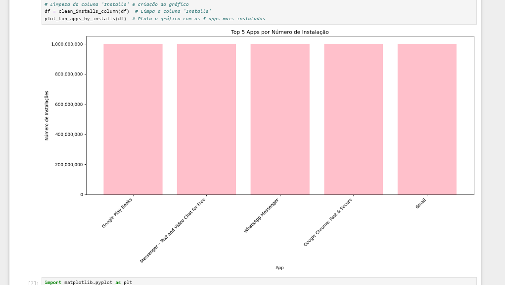

### 5. **Análise de Categorias de Apps**

Gerei um gráfico de pizza para visualizar a distribuição das categorias de aplicativos na Play Store aqui usei matplotlib para representar as proporções. Essa foi a primeira versão, de dificil visualização:

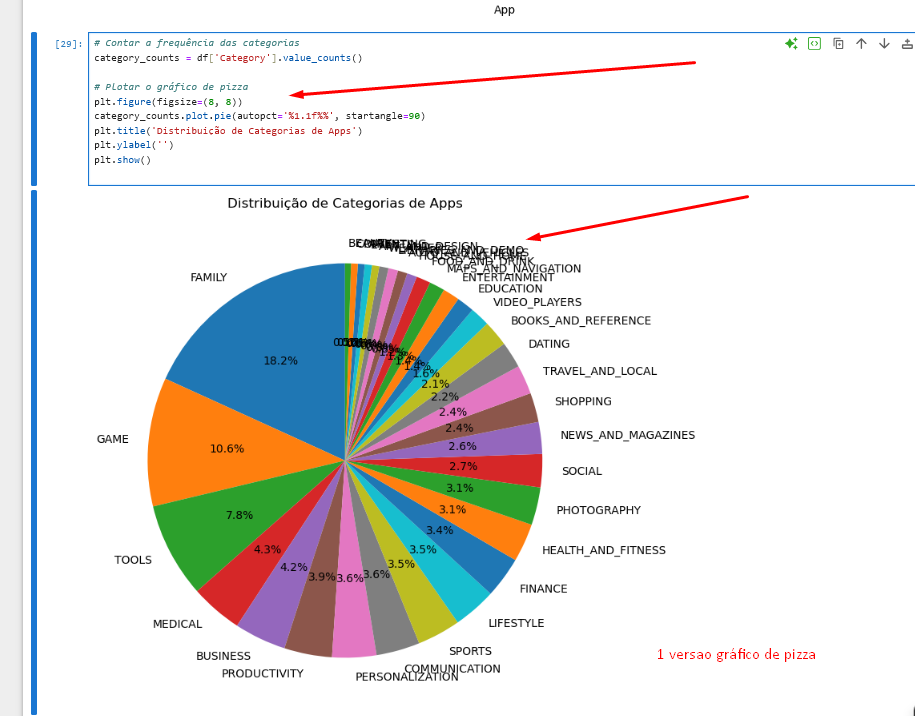

Após os ajustes para melhorar a visualização trazendo somente as 20 categorias mas frequentes ajustando diversos pontos como: legibilidade, layout e evitar as sobreposicões,  o gráfico final ficou da seguinte maneira:

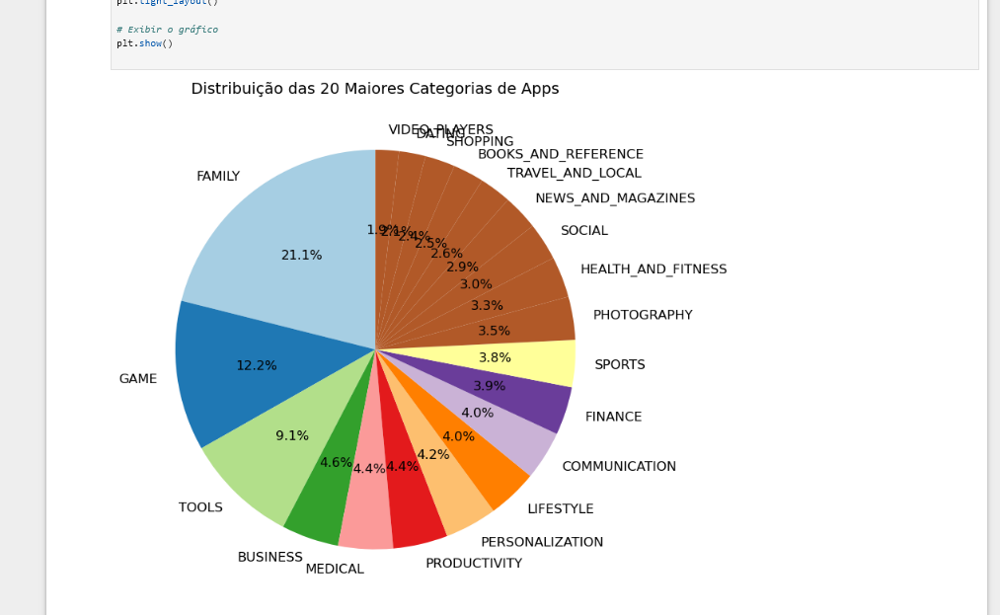

### 6. **Encontre o App Mais Caro**

Aqui, determinei o aplicativo mais caro do dataset, com nome e preço.

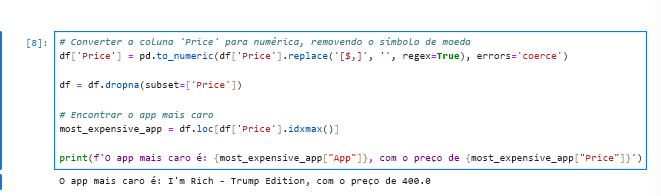

### 7. **Contagem de Apps com a Classificação 'Mature 17+'**

Aqui contei quantos aplicativos possuem a classificação **'Mature 17+'**.

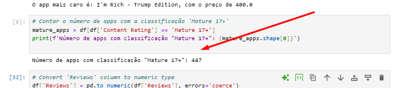

### 8. **Top 10 Apps por Número de Reviews**

Selecionei os 10 aplicativos com mais reviews e gerei um gráfico para visualização seguindo a lógica do gráfico de barras já feito anteriormente.

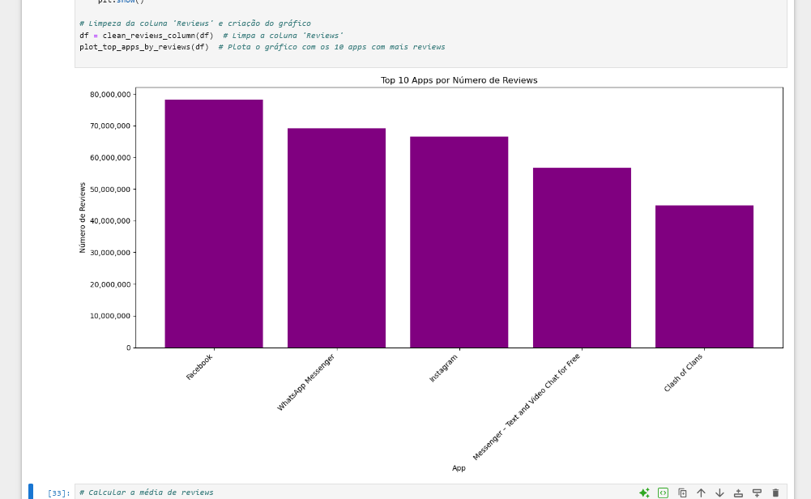

### 9. **Cálculos sobre o Dataset**

Realizei alguns cálculos sobre o dataset, como a média de reviews, cálculo em valor e o cálculo em formato de lista, top 5 apps com mais reviews

### 10. **Gráficos de Análise Adicional**

Gerei gráficos adicionais para os indicadores da etapa anterior, um gráfico de linhas e outro de ponto.

## Conclusão

Este desafio me proporcionou uma análise detalhada do dataset de aplicativos da Google Play Store, focando na distribuição das categorias, popularidade e preço médio. Aprendi a limpar e preparar os dados usando pandas, além de criar gráficos de diferentes tipos e como melhorá-los com o matplotlib. O desafio foi crucial para o aprimoramento das minhas habilidades em análise e visualização de dados.