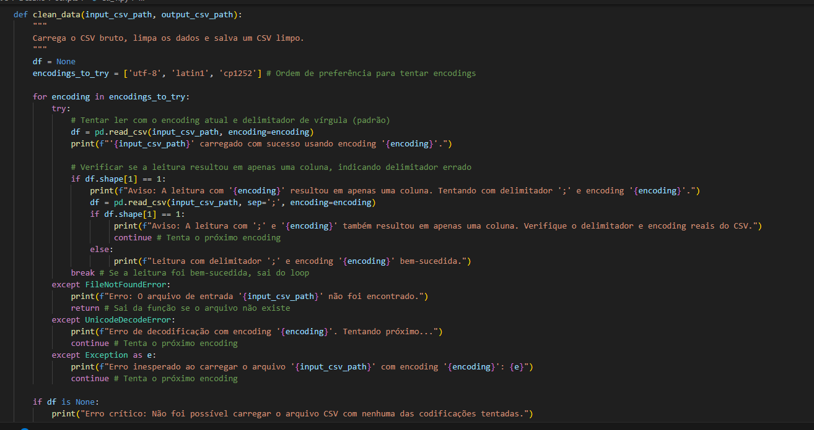
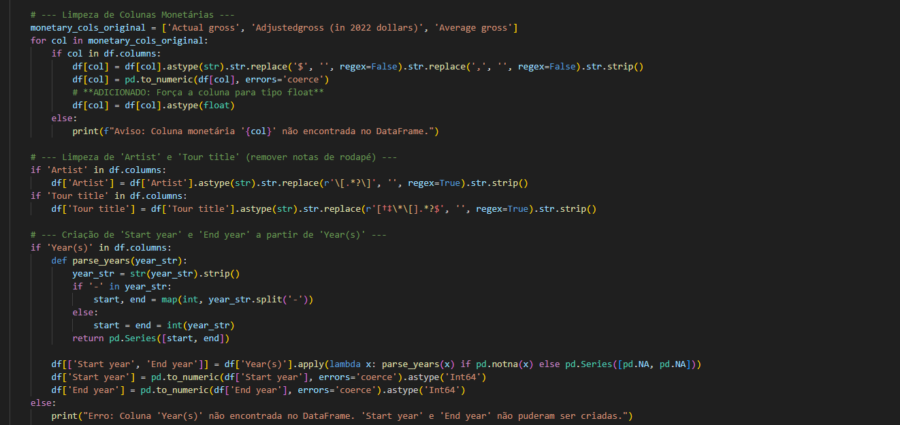
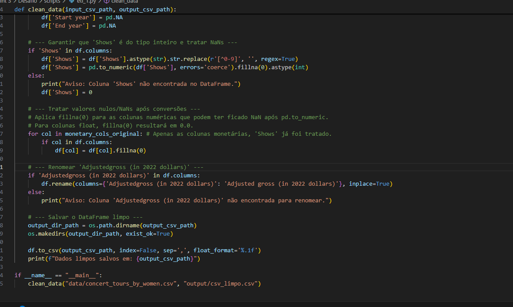
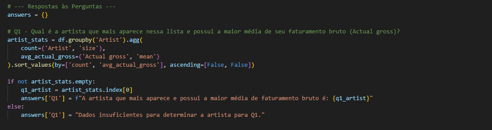
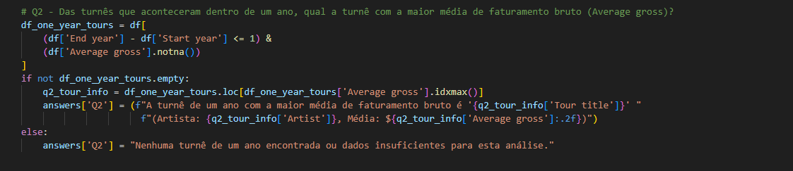
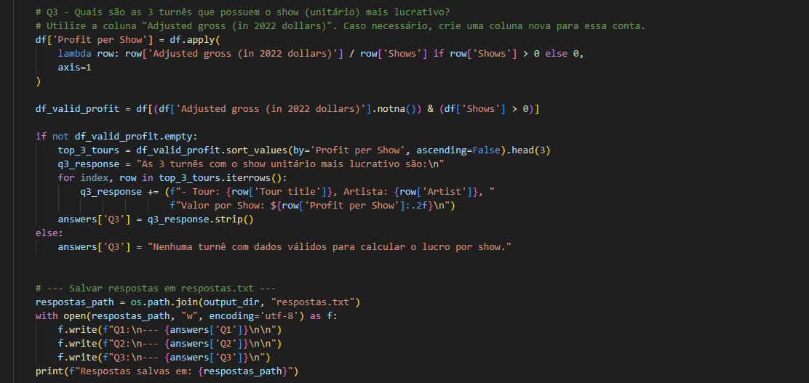
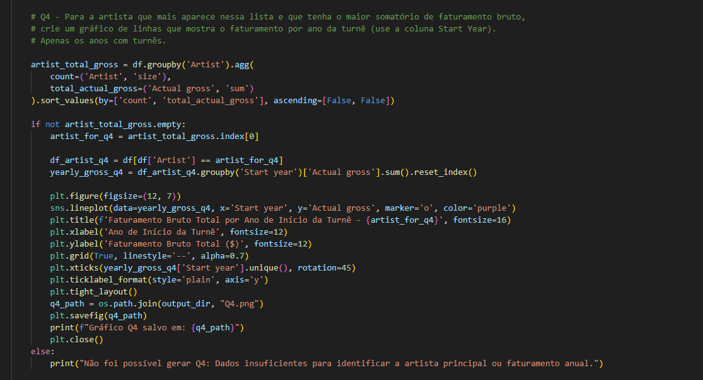
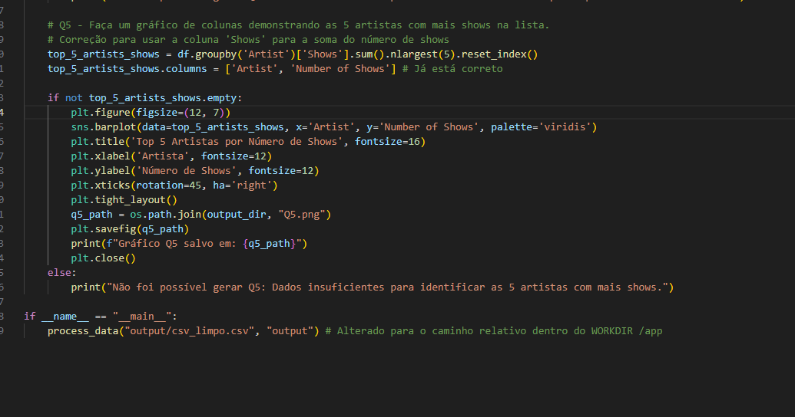

# Etapas

### Etapa 1. **Carregar o Dataset e Remoção das Linhas Duplicadas**

A primeira etapa do projeto é carregar o dataset das turnês dos artistas. O arquivo `.csv` foi carregado e visualizado as primeiras linhas para verificar os dados disponíveis. 

### Etapa 2. **Limpeza de Dados - Ajuste de Valores Monetários e Anos**

Na segunda etapa, temos a limpeza de dados financeiros. As colunas como **`Actual gross`** e **`Average gross`** continham símbolos monetários e vírgulas, que foram removidos. Também foi feita a conversão dessas colunas para valores numéricos. As colunas **`Year(s)`** foram divididas em **`Start year`** e **`End year`** para permitir uma análise temporal mais precisa.

### Etapa 3. **Análise de Artista com Maior Faturamento Bruto**

Na análise de artistas, foi determinado qual artista mais aparece na lista e possui a maior média de faturamento bruto. Usei **`groupby()`** para agregar os dados por artista, considerando tanto a quantidade de turnês quanto a média de faturamento.

### Etapa 4. **Análise das Turnês com Maior Faturamento Unitário**

Aqui, calculei o faturamento unitário por show de cada turnê, utilizando a coluna **`Adjusted gross (in 2022 dollars)`** dividida pelo número de shows. Identifiquei as 3 turnês mais lucrativas por show.

### Etapa 5. **Análise da Turnê com Maior Média de Faturamento Bruto em um Ano**

 A análise foi feita ao calcular o "lucro por show" de cada turnê, dividindo o Adjusted gross (in 2022 dollars) pelo número de Shows. Depois, o código ordena as turnês por Profit per Show (Lucro por Show) e seleciona a turnê com o maior valor. O resultado foi a turnê The Eras Tour de Taylor Swift, que obteve o maior faturamento por show.

### Etapa 6. **Gráficos de Faturamento por Ano de Turnê**

Gerei um gráfico de linhas mostrando o faturamento anual das turnês para o artista com maior faturamento total, destacando os anos com maior sucesso.

### Etapa 7. **Análise dos Top 5 Artistas com Mais Shows**

Na Etapa 7, a análise dos Top 5 Artistas com Mais Shows foi feita utilizando o groupby() para agrupar os dados por Artist e somar o número de shows. Em seguida, utilizamos sort_values() para ordenar os artistas em ordem decrescente com base no total de shows, e selecionamos os 5 primeiros com head(5).
O gráfico gerado é um gráfico de barras que mostra os 5 artistas com o maior número de shows, visualizando facilmente quem são os mais ativos nas turnês.

### Etapa 8. **Exportação dos Resultados e Gráficos**

Os resultados da análise foram salvos no arquivo **`respostas.txt`**, enquanto os gráficos gerados foram exportados como **`Q4.png`** e **`Q5.png`**.

## Conclusão

Este projeto aprofundou meus conhecimentos em análise de dados com pandas, matplotlib e seaborn e também me permitiu praticar o conehcimento aprendido em Docker. Ao utilizar Docker para criar ambientes isolados para cada etapa do processo (ETL e processamento de dados), aprendi a configurar e rodar containers de forma eficiente, garantindo portabilidade e reprodutibilidade do projeto. Essa experiência foi essencial para aprimorar tanto minha capacidade de análise de dados quanto minha familiaridade com a containerização e sua aplicação prática.