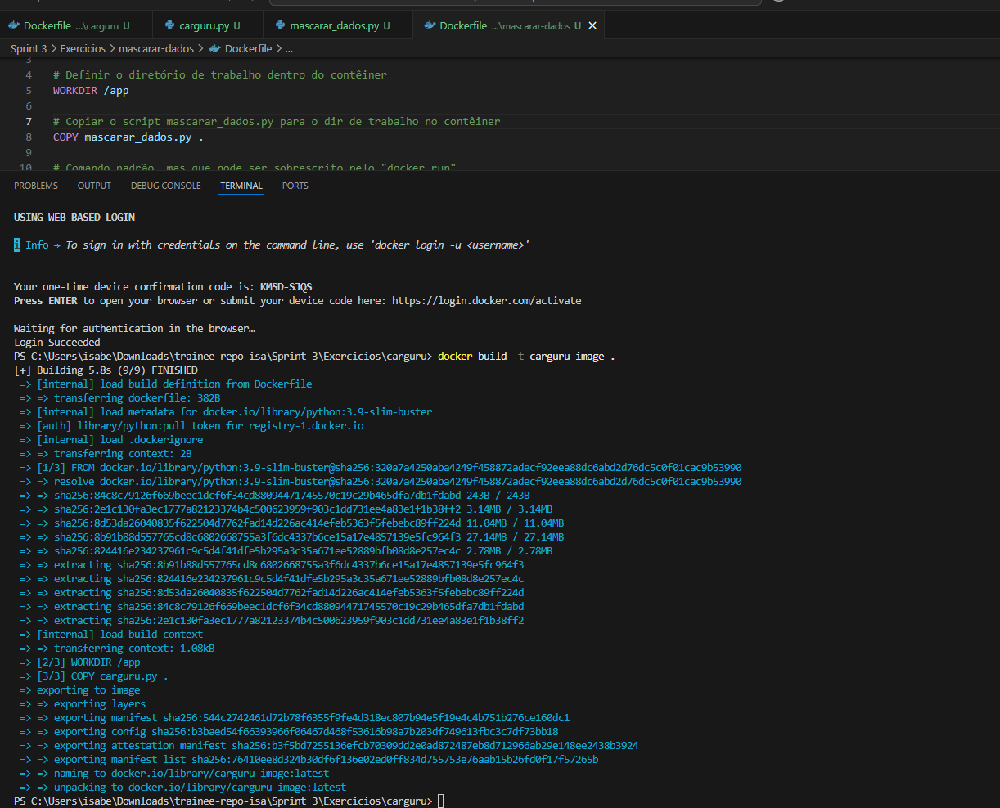
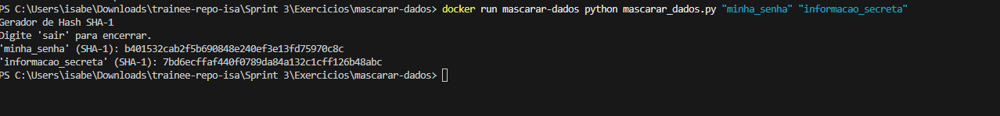
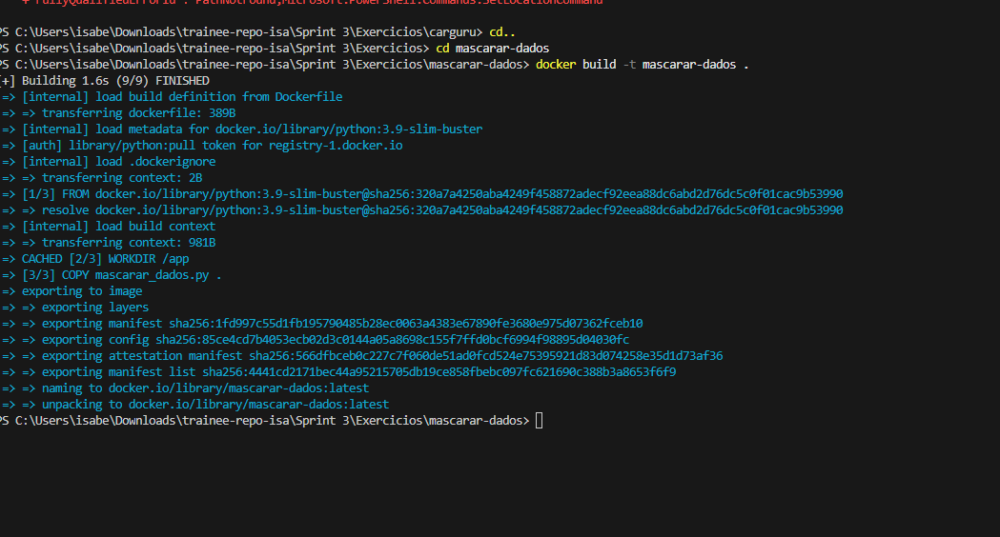
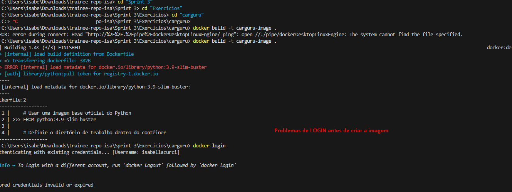

# Resumo

**Docker:** Nesta sprint, aprofundei meus conhecimentos em Docker, aprendendo a construir e gerenciar containers de forma eficiente. A partir do curso "Docker para Desenvolvedores (com Docker Swarm e Kubernetes)", estudei desde os fundamentos da criação de imagens Docker até a orquestração de múltiplos serviços com Docker Compose. Aprendi a utilizar Dockerfile para automatizar a criação de ambientes, trabalhar com volumes e redes, e criar containers que se comunicam entre si de maneira segura e isolada.

**Containers e Imagens:** Compreendi como os containers funcionam como instâncias isoladas de aplicações, criadas a partir de imagens. Aprendi a escrever arquivos Dockerfile para personalizar essas imagens, incluindo a instalação de dependências, cópia de arquivos e definição de comandos de entrada. A prática de build e run de containers reforçou o entendimento do ciclo de vida de uma aplicação em ambiente containerizado.

**Redes e Volumes:** Explorei o uso de redes customizadas para permitir a comunicação entre containers, especialmente em cenários com múltiplos serviços como backend e banco de dados. Também utilizei volumes para persistência de dados entre sessões dos containers.

**Orquestração com Docker Compose:** A utilização do Docker Compose foi fundamental para gerenciar múltiplos containers de forma simultânea. Com arquivos docker-compose.yml, consegui declarar os serviços, suas dependências, volumes e redes de maneira organizada, podendo visualizar como funciona a reprodução do ambiente em diferentes máquinas.

**AWS Partner:** Durante o curso adquiri uma base sólida sobre computação em nuvem com foco no ecossistema da AWS. Compreendi os principais conceitos de nuvem, como elasticidade, escalabilidade, alta disponibilidade.. Estudei a infraestrutura global da AWS, entendendo a importância das regiões, zonas de disponibilidade e como garantir desempenho, segurança e resiliência. Explorei os principais serviços da AWS, como EC2, S3, RDS, Lambda, VPC e DynamoDB, aprendendo sobre os diferentes tipos de serviços da AWS (computação, armazenamento, banco de dados) e suas funcionalidades específicas. Aprendi sobre o modelo de responsabilidade compartilhada em segurança e as boas práticas de compliance na nuvem. O curso trouxe questões na vida real para solidificar meu conhecimento. 

---

# 📦 Exercícios com Docker

Este repositório contém os scripts e arquivos utilizados para praticar os conceitos de Docker. Os exercícios foram executados em ambiente local com Docker e Visual Studio Code, baseados nos exemplos e projetos do curso.

# Lista de Atividades

## 🧪 mascarar_dados.py

Um script interativo para gerar hashes SHA-1 a partir de strings fornecidas pelo usuário ou pela linha de comando. Demonstrar o empacotamento de um programa Python simples em um container Docker. O script é executado diretamente no terminal do container. Ao iniciar o container, o usuário pode digitar qualquer palavra e receber como resposta seu hash SHA-1.

Dockerfile: Define uma imagem baseada no Python 3 e copia o script para dentro do container, com o ponto de entrada configurado para python mascarar_dados.py.

## 🚗 Dockerfile carguru.py

Cria uma imagem Docker personalizada baseada na imagem oficial de python. Ele define o diretório de trabalho /app dentro do container, copia o script carguru.py para esse diretório e configura o container para executá-lo automaticamente ao ser iniciado. Ao rodar o container, o script é executado e exibe aleatoriamente um modelo de carro no terminal.

---

## Evidências da Sprint

## 🖼️ Evidências da Sprint

As imagens abaixo comprovam a criação, execução e testes dos containers durante os exercícios práticos com Docker:

### Criação e Execução

- **Criação da Imagem Docker**
  

- **Execução do Container com carguru.py**
  

### 🔐 Testes com mascarar_dados.py

- **Execução do Script mascarar_dados.py no Container**
  

### ❌ Erros durante o processo, problemas com o login

- **Erro de Login**
  

---

# Conclusão

> Esta sprint foi essencial para consolidar os conceitos de desenvolvimento com containers, permitindo a construção de ambientes portáteis, escaláveis e fáceis de manter.
