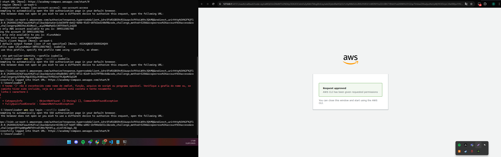
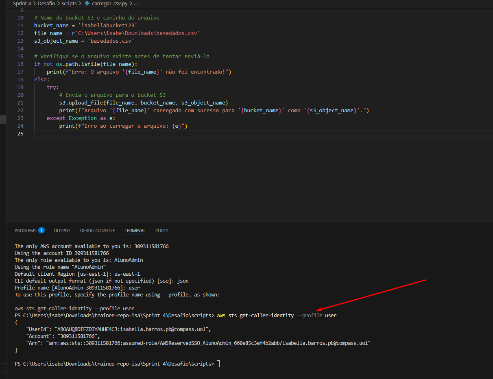
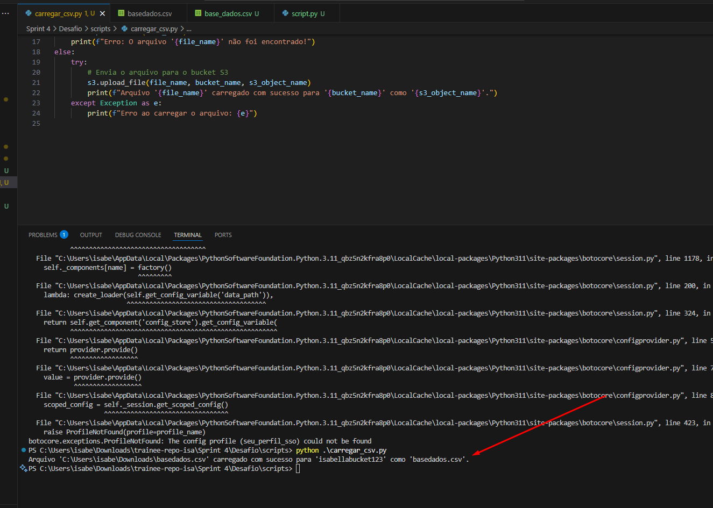
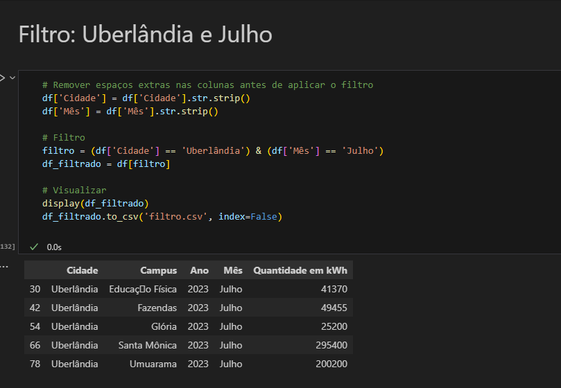
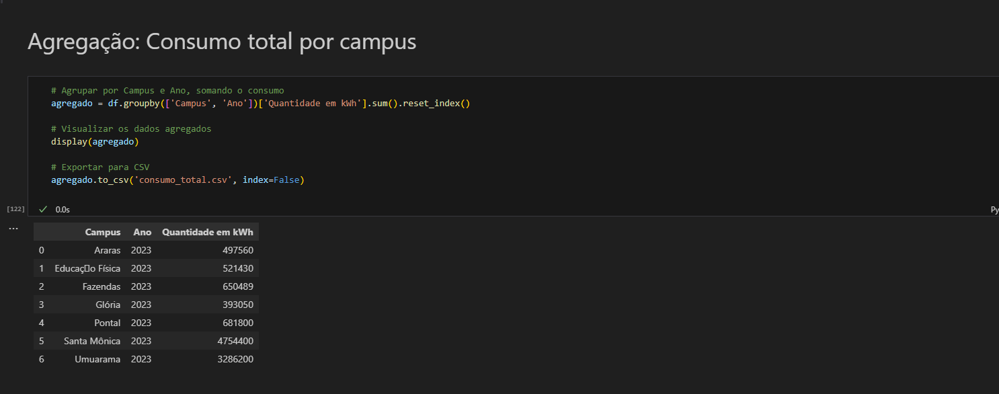
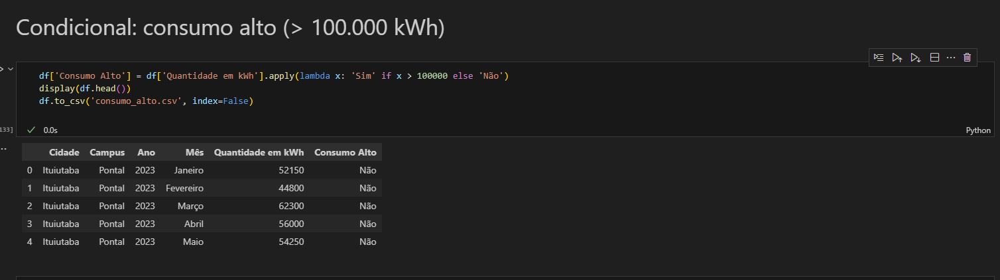
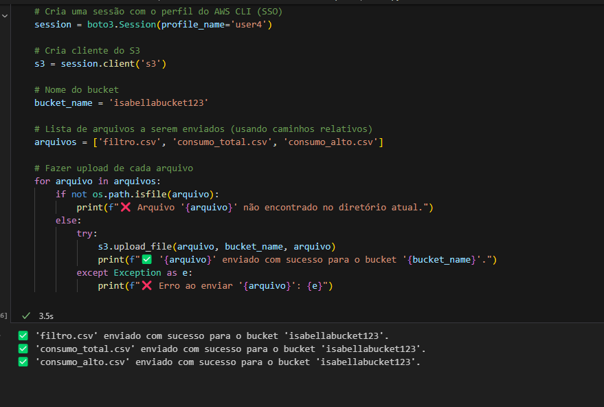

# Etapas

### Etapa 1. **Upload do Dataset para o Amazon S3**

O dataset foi escolhido localmente e analisado para entender sua estrutura e possíveis questionamentos. Em seguida, foi criado um bucket na AWS S3 usando a biblioteca **boto3**. O arquivo `.csv` foi carregado diretamente do ambiente local para o bucket via script Python. Nessa etapa configurei o AWS CLI, via terminal com as senhas e tokens, região necessária, após isso, o carregamento do `.csv`.

 Comecei fazendo por script python, segue abaixo como fiz:

### Etapa 2. **Análise e Manipulação de Dados com Pandas**

Com o arquivo já armazenado no S3, foi utilizado o **pandas** para ler diretamente o dataset do bucket sem realizar download local. A partir disso, foram feitas as seguintes análises:

#### ✅ **1. Qual foi o gasto energético por campus na cidade de Uberlândia no mês de Julho?**  
> Tipo: Filtro com dois operadores lógicos  
Foi aplicado um filtro com múltiplas condições: `Cidade == Uberlândia` **e** `Mês == Julho`, e em seguida foi feito um agrupamento por `Campus`.

#### ✅ **2. Qual o consumo total por campus?**  
> Tipo: Função de agregação (`groupby` + `sum`)  
Foi feito um agrupamento por `Campus` com a soma total da coluna `Quantidade em kWh` para identificar quais campus tiveram maior consumo.

#### ✅ **3. Considerando que consumo alto é acima de 100.000 kWh, quais campus registraram consumo alto?**  
> Tipo: Função condicional (`apply`)  
Foi criada uma nova coluna chamada `Consumo Alto`, marcando como "Sim" quando o valor excedia 100.000 kWh.

### Etapa 3. **Salvamento dos Resultados no S3**

Após a realização das análises e manipulações solicitadas, os resultados foram salvos em formato `.csv` e enviados para o mesmo bucket do S3, respeitando o formato de entrada.

## Conclusão

Esse desafio permitiu o uso prático de manipulação de dados com **pandas**, interação com **Amazon S3** utilizando **boto3**, e boas práticas para manter o processamento 100% na nuvem. Além disso, reforçou o uso de funções essenciais para tratamento e análise de dados em Python, garantindo uma abordagem automatizada, eficiente e segura.
