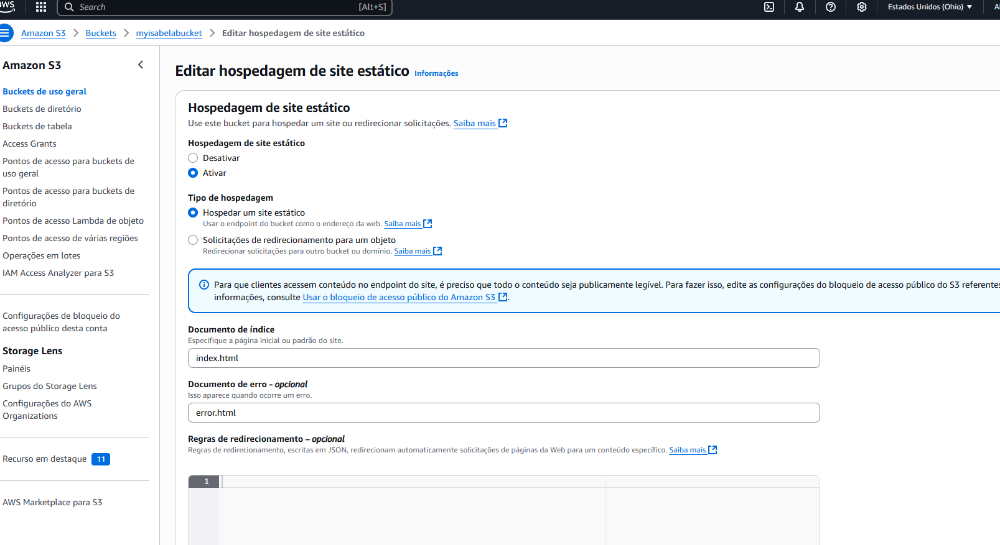
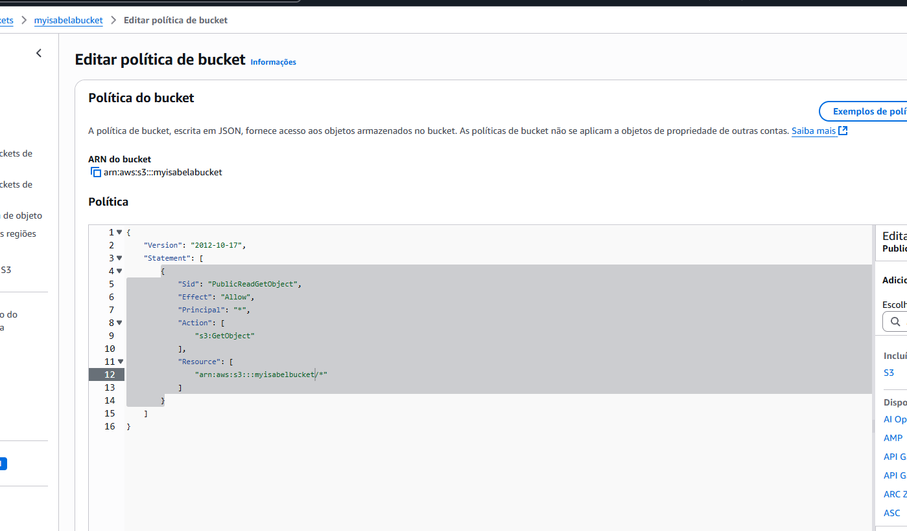
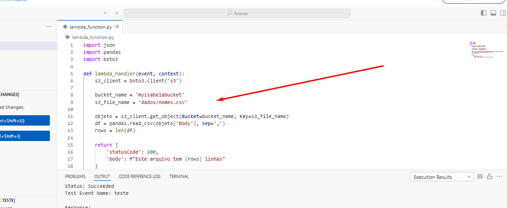
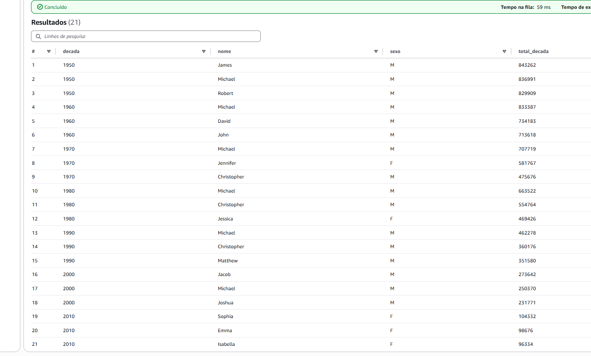

# Resumo

## ☁️ Cursos AWS 

### **Cloud Economics na AWS**
Durante esta sprint, fiz o curso "AWS Partner: Cloud Economics", que focou na compreensão e comunicação dos benefícios econômicos ao adotar soluções de nuvem. Através deste curso, estudei os conceitos do AWS Cloud Value Framework e como ele pode ser utilizado para convencer clientes sobre os benefícios financeiros de migrar para a AWS. O curso abordou práticas recomendadas para o gerenciamento financeiro na nuvem e como fazer que os clientes percebam as vantagens de custo da nuvem AWS.

### **Sales Accreditation (Business)**
O curso "AWS Partner: Sales Accreditation" foi focado em fornecer as habilidades necessárias para articular o valor comercial da AWS com os clientes. Aprendi sobre os principais serviços da AWS, como EC2, S3, RDS, Lambda, e a importância de vendas eficazes em nuvem, além de como lidar com objeções comuns. Através de ferramentas e modelos mentais fornecidos, fui capaz de entender como vender serviços da AWS de maneira alinhada aos objetivos de negócio dos clientes.

### **Cloud Quest**
O Cloud Quest proporcionou uma abordagem prática e interativa para aprender a usar os serviços da AWS. Você foi capaz de configurar, gerenciar e otimizar serviços de nuvem em diferentes cenários de negócios, além de desenvolver uma compreensão profunda sobre segurança, custos e práticas recomendadas. Este curso é uma ótima base para quem deseja expandir suas habilidades em cloud computing e serviços da AWS.

---

## 🛠️ Práticas com AWS

Durante essa sprint, participei de exercícios práticos em serviços essenciais da AWS, como **S3**, **Athena** e **Lambda**. As atividades incluíram a criação de **Buckets** no S3, o desenvolvimento de **Layers**, funções Lambda, e a manipulação de bancos de dados, entre outros.

### **Principais Atividades:**

#### 1. **Criação de Buckets no S3**
   - Criação de **Buckets** no S3 para armazenamento de dados.
   - Configuração de permissões de acesso e políticas de segurança.
   - Carregamento de arquivos e gerenciamento de objetos dentro do bucket.

#### 2. **Funções Lambda e Camadas**
   - Desenvolvimento de funções Lambda para processar dados.
   - Criação de **Layers** personalizados.
   - Teste e execução de funções Lambda com arquivos no S3.

#### 3. **Banco de Dados com Athena**
   - Configuração de consultas SQL no Athena para análise de dados armazenados no S3.
   - Execução de consultas com CSV.

---

## 📸 Evidências da Sprint

### **Criação e Testes:**

- **Criação de Bucket no S3**
  

- **Editando Política**
  

- **Execução de Função Lambda para Processamento de Dados**
  

- **Resultado da Consulta Lab Athena**
  

#### Mais evidências do LAB Lambda em: [Evidencias_LABLambda](./Exercicios/LAB_LAMBDA/)
#### Mais evidências do LAB Athena em: [Evidencias_LABAthena](./Exercicios/LAB_ATHENA/)
#### Mais evidências do LAB S3 em: [Evidencias_LABS3](./Exercicios/LAB_S3/)

---

## 📝 Conclusão

Esta sprint foi fundamental para aprender mais sobre a AWS e suas principais ferramentas. Através dos cursos de **Cloud Economics** e **Sales Accreditation**, aprendi como articular e vender soluções AWS para clientes, com o **Cloud Quest** foi introduzido a prática de uma maneira descontraída. Os exercícios práticos com **S3**, **Athena** e **Lambda** me ajudaram a consolidar minhas habilidades no uso de serviços em nuvem. Durante os exercícios, não tive nenhum impedimento, apenas por ser algo novo alguns desafios, mas no geral muito bem explicado o passo a passo.