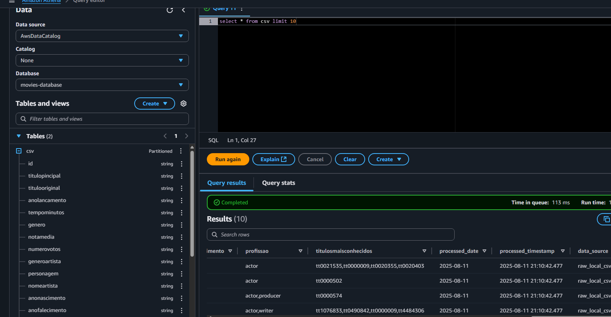

# Desafio Sprint 6 – Processamento de Dados com AWS Glue

## Visão Geral

Neste desafio, o objetivo foi processar e organizar dados de filmes utilizando o AWS Glue, preparando-os para análise na Trusted Zone do Data Lake e consulta via Athena.

---

## Etapas Realizadas

### 1. **Preparação dos Dados na Raw Zone**
- Visualizei novamente os arquivos de filmes já ingeridos no bucket, apenas para confirmação nas duas origens do S3:
  - **CSV:** `s3://data-lake-isa1/Raw/Local/CSV/Movies/2025/07/28/`
  - **JSON TMDB:** `s3://data-lake-isa1/Raw/TMDB/JSON/Movies/2025/07/28/`
- Confirmei o formato e o separador correto dos arquivos CSV (`|`).

### 2. **Desenvolvimento dos Scripts Glue**
Desenvolvi dois scripts, necessários para o desafio:
- **job_aws.py:**  
  - Script para ler os arquivos CSV da Raw Zone, usando o separador correto.
  - Realiza limpeza, remove duplicatas e adiciona colunas de metadados (data/hora de processamento, origem, ano, mês, dia).
  - Salva os dados processados em formato Parquet na Trusted Zone, particionando por ano/mês/dia.
- **job_tmdb.py:**  
  - Script para ler os arquivos JSON da Raw Zone (dados do TMDB).
  - Realiza limpeza, remove duplicatas e adiciona colunas de metadados (data/hora de processamento, origem, ano, mês, dia).
  - Salva os dados processados em formato Parquet na Trusted Zone, particionando por ano/mês/dia.

### 3. **Execução dos Jobs no AWS Glue**
- Executei cada script como um Glue Job, garantindo que os dados fossem processados e gravados corretamente na Trusted Zone do S3.

### 4. **Catalogação Automática com Glue Crawler**
- Criei e executei crawlers para as pastas Trusted no S3:
  - `s3://data-lake-isa1/Trusted/Movies/CSV/`
  - `s3://data-lake-isa1/Trusted/Movies/JSON/`
- Os crawlers criaram as tabelas no Glue Data Catalog, reconhecendo os partições e os nomes corretos das colunas.

### 5. **Consulta dos Dados no Athena**
- No Athena, selecionei o database criado pelo crawler.
- Realizei consultas SQL para validar os dados processados e esse foi um dos resultados das consultas (usando o LIMIT 10): 

---

## Estrutura dos Arquivos

- `job_aws.py` – Script Glue para processar arquivos CSV locais.
- `job_tmdb.py` – Script Glue para processar arquivos JSON do TMDB.
- Dados processados salvos em Parquet na Trusted Zone do S3.
- Tabelas criadas automaticamente no Glue Catalog via crawler.

## Conclusão

## Conclusão

Esse desafio foi muito importante para meu conhecimento acerca do AWS Glue, utilizando além dele outros serviços e os integrando, como o próprio Glue Crawler com integração com o Athena, muito legal ver o projeto tomando forma e se enriquecendo. 

