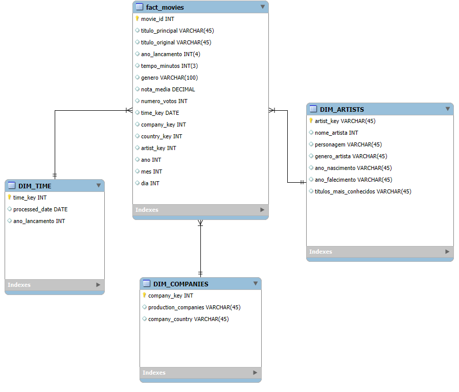
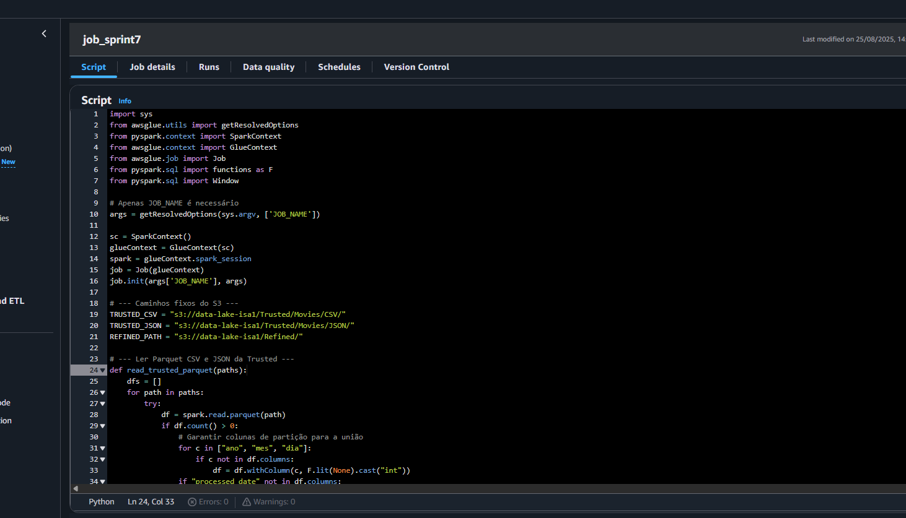
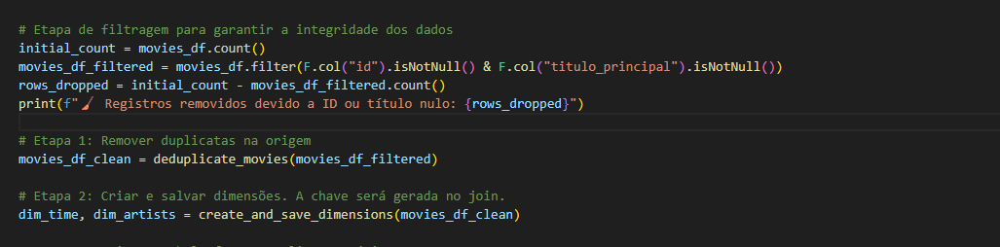
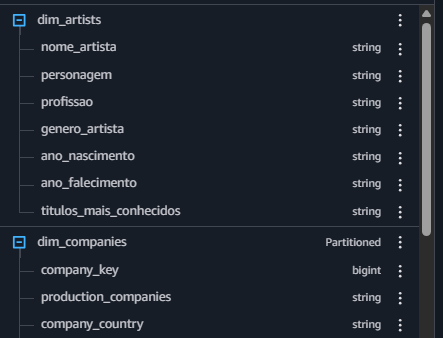
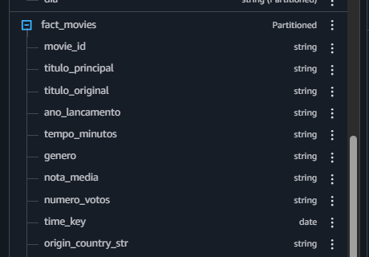
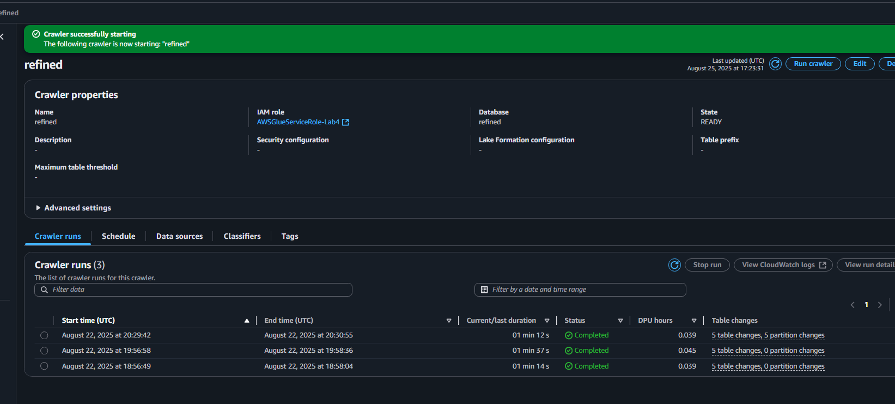

# Desafio Etapa 4 - Processamento de Dados com AWS Glue

## Visão Geral

Neste desafio, o objetivo foi implementar a camada Refined do data lake, aplicando modelagem dimensional aos dados de filmes utilizando AWS Glue e Apache Spark para preparar dados estruturados prontos para análise e visualização.

---

## Etapas Realizadas

### 1. **Modelagem de Dados da Camada Refined**
- Desenvolvi o modelo dimensional seguindo o padrão Star Schema com:
 - **Tabela Fato:** fact_movies (contendo métricas e chaves estrangeiras)
 - **Tabelas Dimensão:** dim_artists, dim_companies, dim_time
- Defini os tipos de dados adequados para cada campo baseado na estrutura real dos dados
- Criei o diagrama ERD documentando os relacionamentos entre as tabelas, baseado nas questões desenvolvidas na Sprint 5.

Tranquilo de desenvolvimento, por já ter realizado em sprints anteriores.

### 2. **Desenvolvimento dos Jobs AWS Glue**
- **Configuração do Job:**
- Seguindo o lab de glue - nenhum impedimento aqui
- Única maior complexidade aqui foi a lógica da implementação, mas com o conhecimento de Spark, sprints passadas, foi possivél cumprir todos requisitos.

 
- **Processamento implementado:**
 - Leitura dos dados da camada Trusted Zone
 - Transformação seguindo o modelo dimensional definido
 - Aplicação de regras de limpeza e estruturação (normalização de dados e filtragens)

 

### 3. **Processamento com Apache Spark**
- Utilizei PySpark para transformar os dados da camada Trusted para Refined
- Implementei job com origem nos dados da Trusted Zone e destino na Refined Zone
- Apliquei todas as transformações necessárias seguindo os princípios de modelagem multidimensional

Exemplo no Athena:

 
 

### 3. **Criação do Crawler e visualização no Athena**
- Criei um banco de dados, cataloguei e integrei rodando o crawler, criando as tabelas fato e dimensões no banco, seguindo a modelagem dimensional 

 
---

## Estrutura dos Arquivos
- `job.py` – Script Glue para processamento da camada Refined
- `modelo-der.png` – Diagrama do modelo implementado

## Conclusão

Esta etapa foi fundamental para consolidar o conhecimento sobre modelagem dimensional e processamento de dados. A implementação da camada Refined utilizando AWS Glue e Apache Spark permitiu estruturar os dados seguindo melhores práticas de Data Warehousing, preparando uma base sólida para análises multidimensionais e visualizações futuras no QuickSight.