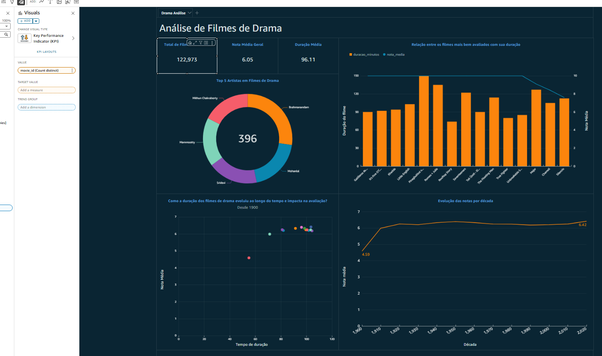

# Desafio Sprint 9 – Desenvolvimento de Dashboard de Visualização no QuickSight

## Visão Geral

Neste desafio, o objetivo foi desenvolver um dashboard interativo de Business Intelligence utilizando **Amazon QuickSight**, consumindo dados da camada **Refined** do Data Lake. O foco foi analisar filmes de drama, trazendo insights sobre artistas, duração, notas médias e evolução histórica dos filmes.

---

## Etapas Realizadas

### 1. **Preparação dos Dados na Camada Refined**
- Utilizei os dados já tratados e estruturados na **Refined Zone**, garantindo que estivessem prontos para consumo no QuickSight.  
- As tabelas foram consultadas via **Athena**, servindo como fonte de dados para o dashboard.

### 2. **Configuração da Fonte de Dados no QuickSight**
- Configurei a conexão do QuickSight com o **Athena**, apontando para as tabelas da Refined Zone.  
- Realizei ajustes de tipos de dados e criei campos calculados quando necessário (ex.: métricas de duração e avaliação).

### 3. **Construção do Dashboard**
Desenvolvi o dashboard **"Análise de Filmes de Drama"** contendo diferentes visualizações:
- **KPIs principais**: total de filmes, nota média geral e duração média.  
- **Gráfico de rosca**: Top 5 artistas mais presentes em filmes de drama.  
- **Gráfico de barras + linha**: relação entre os filmes mais bem avaliados e sua duração.  
- **Dispersão**: análise de como a duração dos filmes evoluiu ao longo do tempo e seu impacto na nota média.  
- **Série temporal**: evolução das notas médias por década, desde 1900 até os anos 2000.  

### 4. **Publicação e Compartilhamento**
- O dashboard foi salvo e publicado no QuickSight.  
- A partir dele, é possível explorar e identificar padrões em filmes de drama.

---

## Estrutura do Dashboard

- **Título**: Análise de Filmes de Drama  
- **Métricas principais**: Total de Filmes, Nota Média, Duração Média  
- **Visualizações**:  
  - Rosca (Top 5 Artistas)  
  - Barras + Linha (Avaliação x Duração)  
  - Dispersão (Tempo de duração x Nota Média)  
  - Série Temporal (Evolução das notas por década)  

---

## Conclusão

Esse desafio foi essencial para consolidar meu aprendizado em **Business Intelligence na AWS**, explorando os dados processados e refinados do Data Lake em um contexto visual e analítico.  
O uso do **Amazon QuickSight** trouxe uma camada de **valor estratégico e visual**, permitindo extrair insights sobre filmes de drama de forma clara e interativa.  
